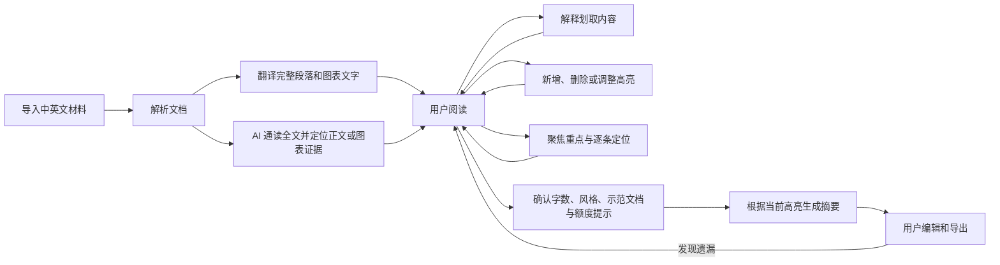

# 长文伴读 MVP PRD

> 日期：2026-08-23  
> 状态：MVP 开发中  
> 项目名：长文伴读  
> 一句话介绍：边读边划，读完成稿。  
> 目标：做出一个版面感知的 OCR 阅读辅助器，保留原 PDF 阅读体验，并根据最终保留的高亮生成摘要。

## 1. 用户最终得到什么

- 目标用户：需要阅读长篇中英文材料，并写成短篇摘要的知识工作者。
- 核心问题：一键 AI 摘要容易选错重点；用户如果完全跳过阅读，也学不到材料里的内容。
- 最终产物：一篇根据当前高亮内容生成的中文摘要。
- 默认长度：2000 字。点击“生成摘要”后，在确认界面设置字数、风格和侧重点。
- 核心动线：通读全文 → AI 划出约四分之一的重点 → 用户阅读、调整 → 生成摘要。例如 8000 字原文先保留约 2000 字证据，再写成 800–3000 字摘要。重点须覆盖各章节的结论、数据、原因、限制和展望。

### 1.1 MVP 明确不做

- 不做多人协作、审批和组织权限。
- 不做手机端精细适配。
- 不接入支付、公开注册或用量计费。
- 不在用户确认交互稿前进入开发。

## 2. 核心对象

### 2.1 原文

- 定义：用户导入的中文、英文或中英混合材料。
- MVP 支持：粘贴纯文本、上传 `.txt` / `.md` 文件、上传数字 PDF 或扫描 PDF。
- PDF 左侧始终保留原始页面；优先使用原生文字和坐标，文字层缺失或异常时自动使用 OCR。
- 英文 PDF：右侧显示正文和图表的中文翻译；图表保留原有图形、配色、位置和数值，只替换文字。目录、作者信息、页眉页脚和页码不进入正文翻译。
- 中文材料：系统不重复翻译，默认使用单栏阅读。
- 中英混合材料：只翻译英文段落。
- 目录：保留原文标题层级，左侧显示中文目录。英文标题翻译成中文，中文标题直接使用原文。
- 多级目录：MVP 支持三级目录。子级标题缩进显示，每级可折叠或展开。

### 2.2 高亮

- 定义：当前保留在原文上的黄色马克笔标记。
- 初始来源：AI 通读全文后，从正文或图表中划出支撑核心结论的关键证据。
- 显示规则：所有高亮使用同一种外观，不标记它来自 AI 还是用户。
- 内容规则：高亮必须对应到原文的具体字符范围。以正文约 20%–30% 为参考，保留完整论点，避免仅划零散句子或重复标记同一事实。
- 点击原文高亮：原文保持原位，只移动译文，让对应中文句子或图表标签与原文选区同高；不得把标题及整段译文一起着色。译文默认显示与原文对应的淡色高亮，点击后加深当前选区。
- 用途：生成摘要时，当前所有高亮都是写作依据。

### 2.3 最终摘要

- 默认语言：中文。
- 默认长度：2000 字。
- 自定义长度：用户可在“目标字数”中输入其他正整数。
- 内容边界：只能写入当前高亮所支持的事实、数据和判断。
- 全文可用于理解代词、上下文和文章结构，但不能借此加入高亮之外的新结论。
- 高亮不足时，摘要可以短于目标字数，不得重复或补写新事实凑字数。

## 3. 主流程

- 用户可随时退出，再次打开时继续上次的阅读位置。
- 用户修改高亮后，旧摘要显示“高亮已变更，需要重新生成”。

## 4. 需求详情

### 4.1 建立阅读任务

- 入口：只从首页的“新建阅读”进入。阅读页不显示“导入内容”。
- 导入页：提供“上传文件”和“粘贴文字”两种方式。
- 上传文件：用户拖入文件或点击“选择文件”。
- 粘贴文字：用户把中英文内容粘贴到可编辑文本区，可在提交前继续选取、删除或修改文字。
- 用户动作：确认内容后点击“开始阅读”。
- 系统结果：识别页面版面，必要时使用 OCR；AI 通读全文后标出正文或图表里的关键证据，并翻译正文与图表文字。
- 处理中：采用方案 A：在一张卡片内显示“识别文档 → 分析全文 → 翻译内容”的单一阶段线；显示实际已完成段数、图表文字项数和阶段耗时。未知进度不显示估算百分比。沿用按内容容量分批的策略，不为更早反馈增加请求。
- 文件无法识别：提示“这份文件没有识别出可阅读内容，请检查页面清晰度后重试。”
- 中途取消：导入页和处理页始终提供“取消处理”；等待后台确认停止后显示“已取消”。保留完成的分析、翻译和高亮，支持“继续处理”；不重做成功批次。新建阅读时重新载入页面代码，避免长期打开的标签页继续使用旧界面。
- 中途失败：保留已完成的段落，用户点击“继续处理”后从中断位置继续。

### 4.2 阅读中英文

- 英文 PDF：桌面端默认左侧原 PDF，右侧显示正文和图表中文。图表以原 PDF 图形为背景，在原位置替换中文标签，保留数字、颜色与几何形状。
- 两栏默认等宽；拖动中间分隔线调整宽度，双击恢复等宽。分隔线支持键盘左右键调整。
- 中文材料：默认使用居中单栏，增加正文宽度。
- 对齐：文本材料按段落对齐；PDF 译文按原文坐标保留标题、栏位、图表和独立引用的位置。翻译变长时顺延同栏后续内容，避免覆盖；跨页完整段落仍保留在起始位置。
- 图表：裁切同时参考文字与真实图形边界；中文保留原标签的左、右或居中对齐、字号比例与粗细。默认尽量按原文尺寸展示，空间不足时等比例缩小，并可点击按原文显示尺寸放大查看。
- 放大的图表支持点击图表以外的区域关闭，也保留关闭按钮和 Escape 键。
- 保真边界：原生 PDF 的图形直接复用原文件，翻译模型只提供文字；扫描件的文字与图形粘连时，不能承诺无损替换。复杂版式需用代表性材料逐页验证。
- 视图：用户可切换“对照”、“原文”和“译文”。中文材料不显示“译文”。
- 翻译原则：保留人名、机构、数字、日期、否定和语气强度。跨页或跨栏的同一段先合并再翻译，完整译文放在起始位置；原文坐标和高亮范围保留。图表中换行的同一标签也合并翻译。
- 上下滚动：对照视图只有一个共享滚动位置，左右两侧不能各自滚动导致错位。
- 进度条：阅读区右边缘持续显示细长的垂直滚动进度条，拖动可快速跳转。
- 阅读进度：不在顶部单独显示百分比。左侧目录底部在页码附近显示“23 / 56 页 · 42%”。

### 4.3 划取解释

- 用户在原文或译文中划取内容后，页面在选区附近显示浮动工具条。
- 选区与现有高亮不完全一致时，工具条显示“解释”和“高亮”。
- 选区与某个现有高亮完全一致时，工具条显示“解释”和“取消高亮”。
- 用户没有划取，只是点击某个现有高亮时，工具条同样显示“解释”和“取消高亮”。
- 用户点击“解释”后，浮动工具条消失，原位置显示释义卡片。
- 系统结合当前段落和全文主题，用中文解释这个词或句子在本文中的意思。
- 解释默认不超过 150 字，先说本文中的意思，再补充必要背景。
- 释义卡片底部显示“继续追问…”输入框和“发送”按钮。追问继续使用同一选区和文章上下文。
- 用户点击“高亮”，划取内容立即变成黄色马克笔标记。如果选区与原高亮部分重叠，系统合并重叠范围，不显示叠加颜色。
- 用户点击“取消高亮”，对应高亮立即删除。
- 无法确定时，明确写“仅根据本文无法确定”。

### 4.4 编辑高亮

- 默认外观：半透明黄色马克笔，文字保持可读。
- 新增：用户划取任意原文，在浮动工具条点击“高亮”。
- 调整：PDF 高亮以半透明蒙层覆盖在原页面文字上；用户拖动蒙层两端，系统实时扩大或缩小高亮。
- 删除：鼠标悬停在高亮上时，高亮右上方显示删除键。用户点击后立即删除。
- 撤销：新增、调整或删除高亮后，页面底部显示 5 秒“撤销”入口。
- 显示边界：不显示“AI 建议”、“已确认”、建议理由或高亮数量统计。
- 保存：每次修改立即保存，刷新页面不丢失。
- 新增、删除和调整高亮只更新局部文字与蒙层，保留 PDF 页面和滚动位置。拖动边界时，译文范围实时跟随；图表高亮按中文文字的实际范围显示。
- 对齐精度：已有句子对应关系用于整句定位；句内微调按比例近似映射，不宣称逐词语义对齐。

### 4.5 聚焦重点

- 入口：顶部工具栏的“聚焦重点”，替代原来的“查看重点”。
- 当前版面保持不变，非高亮区域轻柔模糊、淡化，高亮文字保持清晰；退出后恢复正常阅读。
- 浮动导航显示当前重点序号，支持上一条、下一条；原文、译文和对照视图均可使用。
- 不调用模型，不改写材料，不产生新文章。

### 4.6 生成摘要

- 入口：顶部工具栏的“生成摘要”。
- 设置：点击入口后弹出确认界面，设置目标字数（默认 `2000`）、摘要风格（分析文章、决策简报、要点提纲）和可选侧重点。阅读工具栏不再显示字数框。
- 额度提示：确认界面告知使用的实际模型额度。DeepSeek 模式明确提示会消耗用户 DeepSeek 额度；本地 Codex 模式明确提示使用 Codex 额度、不消耗 DeepSeek 额度。
- 风格示范：首页与摘要设置均可上传、查看和移除示范文档，共用一份已保存列表，最多 5 份。支持 PDF、TXT、Markdown，每份最多 25 MB。
- 示例仅提供语气、结构和表达参考，不作为摘要事实来源。读取文档时不单独调用风格分析模型；生成摘要时，每份取不超过约 6000 字符的代表片段，一起发送给模型，并告知用户。
- 无高亮：不生成，提示“还没有高亮内容。请先划出重点。”
- 字数无效：不生成，提示“请输入大于 0 的目标字数。”
- 系统根据点击生成时的全部高亮写成摘要。
- 摘要页内，用户点击任一段可查看它使用的原文高亮。
- 用户可直接编辑摘要，并复制纯文本或导出 Markdown。
- 生成失败时，保留上一版成功摘要。
- 生成中显示阶段、动态进度条和已用时间，不虚构完成百分比；刷新或返回后可查看已保存的生成状态，重复提交不会启动第二次生成。

### 4.7 任务列表和续读

- 首页显示任务名、原文字数、阅读进度和最后更新时间。
- 打开任务时，自动回到上次阅读的段落。
- 状态：“处理中”、“已取消”、“阅读中”、“摘要已生成”、“处理失败”。

## 5. MVP 运行方式和数据边界

- 网页在开发者自己的电脑上运行。
- 网页通过本地服务调用已登录的 Codex CLI，不向使用者要求 API key。
- 原文、翻译、高亮和摘要保存在本地。
- Codex CLI 不等于离线模型。导入前提示：“请勿导入不允许发送给外部 AI 的材料。”

### 5.1 线上个人 Key 版本

- 线上默认使用 `deepseek-v4-flash`（界面显示 DeepSeek V4 Flash），每位用户绑定自己的 DeepSeek API Key；不会退回使用服务器共享 Key。
- Key 仅保存在当前浏览器，调用时经本站服务临时转发给 DeepSeek，不写入服务器文件、任务、云存储或日志。提供验证、查询余额、更换及解除绑定。
- 暂不建设个人账号。浏览器生成独立的随机阅读空间凭据，服务器仅用其摘要作为私有存储命名空间；报告、原 PDF 和示范文档均隔离。知道别人的报告 ID 不能访问其内容。
- 解除 Key 不删除报告；清除网站数据会失去阅读空间入口。换设备或浏览器不自动同步。旧版公共命名空间中的资料继续保留，不向新匿名空间自动公开。
- 开始分析、翻译、解释或摘要前检查余额；余额不足时阻止调用。运行中收到 402 时不自动重试，保存已完成结果并显示充值提醒。进入页面、回来继续使用或手动检查时刷新余额，余额较低时提前提醒。
- 通知范围为网页内提醒；本轮不包含邮件、短信或关闭网页后的推送。
- 本地仍使用 Codex `gpt-5.6-sol` / `medium`。线上受托管请求体限制，单次上传总计不超过 4 MB，本地为 25 MB。
- 现有网站访问密码与个人账号不同；是否移除另由用户决定，不能因改为个人 Key 而自动取消。

## 6. 验收

### 6.1 中英文阅读

- 输入：分别导入一份数字 PDF 和一份扫描 PDF，其中至少一页同时包含正文和图表。
- 通过条件：左侧保留原 PDF；数字 PDF 使用原生坐标，扫描 PDF 自动使用 OCR；右侧显示完整段落译文与中文图表，图表数字、配色和图形保持原样，点击图表高亮可定位相应中文。

### 6.2 高亮编辑

- 输入：AI 预先生成若干高亮；用户新增一处、调整一处并删除一处。
- 通过条件：所有高亮外观一致；鼠标悬停时显示删除键；拖动边界可改变范围；刷新页面后修改仍然存在。

### 6.3 划取解释

- 输入：用户分别划取一处新内容、一处与现有高亮完全相同的内容，并直接点击一处现有高亮。
- 通过条件：新选区显示“解释 / 高亮”；后两种情况显示“解释 / 取消高亮”。点击“解释”后工具条消失，释义卡片出现，并可继续追问。

### 6.4 聚焦重点

- 输入：一份含多处高亮的长文。
- 通过条件：非重点内容柔化，高亮仍清晰；连续点击上一条、下一条能定位不同重点，切换到只看译文仍可使用；退出后恢复。

### 6.5 生成自定义长度摘要

- 输入：分别使用默认 `2000` 字和自定义 `800` 字生成摘要。
- 通过条件：两次生成都只使用当前高亮；摘要长度接近用户设置；高亮不足时明确生成更短内容。
- 补充条件：生成前可设置风格、查看额度提示；首页和设置页的示范文档一致，第 6 份被拒绝；生成中刷新仍可看到进度；示范文档里的事实不应混入摘要。

### 6.6 关键失败

- 扫描件 PDF：自动切换 OCR；识别不到正文时明确提示，不生成空翻译。
- AI 处理中断：已完成的段落和高亮仍然保留，继续后不重复处理已成功部分。
- 生成摘要失败：上一版成功摘要仍然保留。

## 7. 交互稿确认项

历史交互稿：[主阅读页 v1](./划重点-主阅读页交互稿-v1.png)

当前交互稿：

- [交互流程稿 v2](./长文伴读-交互流程稿-v2.png)
- [视觉方向 A · 编辑纸本](./长文伴读-视觉方向A-编辑纸本-v2.png)
- [视觉方向 B · 清爽工具](./长文伴读-视觉方向B-清爽工具-v2.png)
- [视觉方向 C · 图形印刷](./长文伴读-视觉方向C-图形印刷-v2.png)

开发前需确认一张高保真交互稿，至少覆盖：

- 英文原文和中文翻译的对照阅读。
- 可折叠的三级中文目录。
- 左右段落顶部对齐。
- 黄色马克笔高亮。
- 高亮的拖动调整状态。
- 高亮悬停时的删除键。
- 划取新内容后的“解释 / 高亮”工具条。
- 点击现有高亮后的“解释 / 取消高亮”工具条。
- 带“继续追问…”的释义卡片。
- “聚焦重点”的柔化效果及上一条、下一条导航。
- 独立“新建阅读”页的上传文件和粘贴文字；阅读页不出现导入按钮。
- 右侧垂直阅读进度条。
- 左下角的“23 / 56 页 · 42%”，顶部不再显示百分比。
- 生成前确认默认 `2000` 字、风格、示范文档及额度提示。
- “生成摘要”入口。

### 7.1 待选视觉方向

- A · 编辑纸本：暖白纸张、衬线正文、细分隔线和黄色马克笔。长时间阅读最舒服，专业但稍偏书卷气。
- B · 清爽工具：接近白色的底、无衬线界面、紧凑工具栏和更明确的状态层级。上手最快，但品牌记忆点较弱。
- C · 图形印刷：米白画布、深蓝文字、偏粗结构线和高饱和黄色高亮。记忆点最强，但需克制装饰，避免影响长文阅读。

## 8. 后续版本（Deferred）

- 个人账号登录、跨浏览器和跨设备同步，以及匿名阅读空间迁移到账号。
- 平台使用自有 API key，按实际模型成本计费。
- 初步定价假设：用户支付实际模型成本的 1.5 倍。正式上线前需计入存储、文件解析、支付通道和税费等其他成本。
- Word 导入与 Word / PDF 导出。
- 跨设备同步和多人协作。

## 9. 待确认

- “长文伴读”是当前工作名。对外发布前需再检查商标、域名和应用名称是否可用。
- 交互稿确认后，再固结具体布局、字体、颜色和组件状态。
